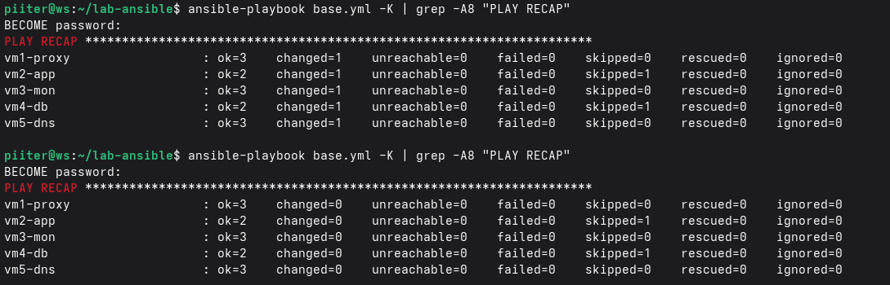
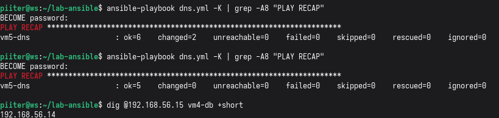
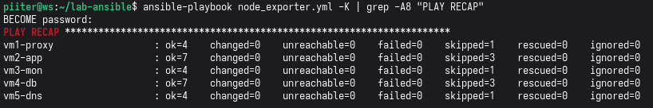

# Automatización con Ansible

## Objetivo

Pasar a código lo que se montó a mano en el laboratorio, de forma que se
pueda repetir y comprobar. Ansible se ejecuta desde `ws` (el nodo de
control) y administra por SSH las 5 VMs de servidor. Cubre la
configuración base, el servidor DNS, `node_exporter`, Docker y el
despliegue de WordPress y MariaDB con las credenciales en Ansible Vault.
El cliente DNS queda para la siguiente fase.

El código está en la carpeta [`ansible/`](../ansible).

## Estructura

```
ansible/
├── ansible.cfg
├── inventory.ini
├── base.yml                  # paquetes comunes
├── dns.yml                   # servidor DNS (VM5)
├── node_exporter.yml         # métricas en todas las VMs
├── docker.yml                # Docker en VM2 y VM4
├── apps.yml                  # MariaDB (VM4) y WordPress (VM2)
├── group_vars/lab/
│   ├── vars.yml              # variables que apuntan al Vault
│   └── vault.yml.example     # plantilla; el vault.yml real no se sube
└── roles/
    ├── dnsmasq/
    │   ├── defaults/main.yml     # tabla de nombres y DNS externo
    │   ├── tasks/main.yml
    │   ├── handlers/main.yml
    │   └── templates/            # lab.conf.j2 y hosts.j2
    ├── node_exporter/
    │   ├── defaults/main.yml     # versión y puerto
    │   ├── tasks/                # main, debian y redhat
    │   ├── handlers/main.yml
    │   └── templates/node_exporter.service.j2
    ├── docker/
    │   ├── defaults/main.yml     # repositorio y paquetes
    │   └── tasks/main.yml
    ├── mariadb/
    │   ├── defaults/main.yml     # directorio e imagen
    │   ├── tasks/main.yml
    │   └── templates/            # docker-compose.yml.j2 y env.j2
    └── wordpress/
        ├── defaults/main.yml     # directorio, imagen, host de la BD y puerto
        ├── tasks/main.yml
        └── templates/            # docker-compose.yml.j2 y env.j2
```

## Inventario

Cinco grupos, uno por función, agrupados en `lab`. Los nombres los
resuelve el DNS interno (ver `docs/vm5-dns.md`), así que no hay IPs en el
inventario:

```ini
[proxy]
vm1-proxy
[app]
vm2-app
[monitor]
vm3-mon
[db]
vm4-db
[dns]
vm5-dns

[lab:children]
proxy
app
monitor
db
dns

[lab:vars]
ansible_user=piiter
```

`ws` no está en el inventario: es la máquina desde la que se ejecuta
Ansible, no uno de sus destinos.

## Cómo se usa

```bash
cd ansible
ansible lab -m ping                       # conectividad
ansible lab -b -K -m command -a "whoami"  # permisos de sudo

ansible-playbook base.yml --syntax-check
ansible-playbook base.yml --check --diff -K   # simulacro
ansible-playbook base.yml -K                  # ejecución real
```

`-K` pide la contraseña de `sudo` en cada ejecución. No se guarda en
ningún archivo del repositorio.

Cualquier comando que toque el grupo `lab` necesita además la contraseña
del Vault, porque las variables cifradas se cargan para todo el grupo
(`--ask-vault-pass`). Sin ella falla con `Attempting to decrypt but no
vault secrets found`.

## Qué hace cada playbook

### `base.yml`
Instala `curl`, `htop`, `tmux`, `tree`, `jq` y `vim` en todas las VMs. El
paquete de `vim` se llama `vim-enhanced` en Rocky y `vim` en Debian y
Ubuntu, y el playbook elige el nombre según la familia de la
distribución. La caché de `apt` solo se actualiza en Debian y Ubuntu.

### `dns.yml` (rol `dnsmasq`)
Configura el servidor DNS de VM5. La tabla de nombres está en una
variable (`dnsmasq_hosts`) y se genera con una plantilla, de modo que la
fuente de verdad es el repositorio y no el archivo de la máquina.

- La configuración se **valida antes de guardarse** con
  `dnsmasq --test -C`, igual que se haría con `named-checkzone` en BIND9.
- Un *handler* reinicia dnsmasq solo cuando cambia algo.

### `node_exporter.yml` (rol `node_exporter`)
Instala y activa `node_exporter` en todas las VMs, con un caso por
familia de distribución:

- **Debian y Ubuntu** (VM1, VM3, VM5): paquete `prometheus-node-exporter`.
- **Rocky** (VM2, VM4): binario oficial en una versión fijada
  (`node_exporter_version`), usuario de servicio, unidad systemd desde una
  plantilla y puerto 9100 en `firewalld`. Si la versión instalada ya
  coincide, no se descarga nada.

### `docker.yml` (rol `docker`)
Instala Docker CE y el plugin de Compose en VM2 y VM4 desde el repositorio
oficial, activa el servicio y añade al usuario al grupo `docker`. El rol
comprueba que la máquina sea de la familia RedHat y falla con un mensaje
claro si no lo es.

### `apps.yml` (roles `mariadb` y `wordpress`)
Despliega las dos aplicaciones con `docker compose`, primero la base de
datos (VM4) y después WordPress (VM2). Cada rol genera el
`docker-compose.yml` y el `.env` desde plantillas, y levanta el proyecto
con `community.docker.docker_compose_v2`.

- El `.env` se crea con permisos `0600`, con `backup: true`, y con
  `no_log` y `diff: false` para que las contraseñas no aparezcan nunca en
  la salida de Ansible.
- WordPress no necesita la contraseña de `root` de la base de datos, así
  que su `.env` solo lleva tres variables.
- El proyecto de Compose toma el nombre del directorio, y como el
  directorio es el mismo que se usaba a mano, los **volúmenes se
  conservan**: los datos no se pierden al pasar a Ansible.

#### Credenciales con Ansible Vault
Las credenciales viven en `group_vars/lab/vault.yml`, cifrado con
`ansible-vault`. `vars.yml` las expone con los nombres que usan las
plantillas:

```yaml
mysql_database: "{{ vault_mysql_database }}"
mysql_user: "{{ vault_mysql_user }}"
mysql_password: "{{ vault_mysql_password }}"
mysql_root_password: "{{ vault_mysql_root_password }}"
```

El `vault.yml` real **no se sube al repositorio** (está en `.gitignore`);
solo se publica `vault.yml.example` con la estructura. Para crearlo:
```bash
cp group_vars/lab/vault.yml.example group_vars/lab/vault.yml
vim group_vars/lab/vault.yml            # valores reales
ansible-vault encrypt group_vars/lab/vault.yml
ansible-vault edit group_vars/lab/vault.yml   # para cambiarlos después
```

Orden recomendado de ejecución en una instalación nueva:
```bash
ansible-playbook docker.yml --check --diff -K
ansible-playbook docker.yml -K
ansible-playbook apps.yml --check --diff -K --ask-vault-pass
ansible-playbook apps.yml -K --ask-vault-pass
```

## Idempotencia

Cada playbook se puede ejecutar varias veces sin efectos secundarios. La
primera ejecución con cambios muestra `changed` y la siguiente
`changed=0`.





## Problemas encontrados

- **`sudo-rs` en Ubuntu (VM1).** Con `-b -K`, Ansible fallaba solo en VM1
  con `Timeout waiting for privilege escalation prompt`. La causa no era el
  DNS ni la red: Ubuntu usa por defecto `sudo-rs`, cuyo prompt
  (`[sudo: authenticate] Password:`) Ansible no reconoce. Se resolvió
  fijando el `sudo` clásico:
  ```bash
  sudo update-alternatives --set sudo /usr/bin/sudo.ws
  ```
  La pista fue el formato del prompt. La primera hipótesis (resolución del
  nombre de la máquina en `sudo`) era errónea y se descartó revisando
  `/etc/hosts` y la salida detallada (`-vvv`).
- **Modo simulacro (`--check`) y módulos `command`.** El rol
  `node_exporter` fallaba solo en simulacro con `Source ... not found`.
  En `--check`, el módulo `command` no se ejecuta, así que Ansible no podía
  saber qué versión había instalada, daba por hecho que no había ninguna e
  intentaba copiar un binario que no se había descargado. Como la consulta
  de versión es de solo lectura, se marcó con `check_mode: false`.
- **La limpieza del DNS no deja efectos en Ansible.** Tras eliminar las
  entradas de `/etc/hosts` de los clientes, el inventario por nombres
  siguió funcionando porque lo resuelve VM5.
- **El `.env` de VM4 tenía las variables desplazadas.** Al pasar los
  despliegues a Ansible se copiaron al Vault los valores del `.env` de
  VM4, y en una primera ejecución real WordPress dejó de conectar
  (`Access denied for user 'wordpress'`, que en realidad era el nombre
  de la base de datos). Comparando huellas (hash) de cada valor entre VM2
  y VM4 se vio que en VM4 cada valor estaba una posición corrida respecto a
  su nombre. Pasó desapercibido porque MariaDB solo lee esas variables la
  primera vez que crea la base de datos, y después las ignora. Los valores
  buenos eran los de VM2, que llevaba días funcionando. Se corrigió el
  Vault, se restauraron los `.env` desde las copias de seguridad que deja
  `backup: true`, y se volvió a ejecutar `apps.yml` con el Vault ya
  corregido.
- **Una ejecución real recreó los contenedores.** En `--check`, el módulo
  de Compose no puede saber que el `.env` va a cambiar, porque en
  simulacro el archivo no se escribe. Por eso un simulacro limpio no
  garantiza que los contenedores no se recreen. Lección: antes de la
  ejecución real, comprobar que los `.env` generados coinciden con los
  existentes, y hacer una copia de la base de datos
  (`mariadb-dump`).
- **Nginx no arrancaba tras reiniciar.** Con el DNS interno, Nginx (VM1)
  fallaba al arrancar con `host not found in upstream "vm2-app"`: resuelve
  el nombre del servidor solo al cargar la configuración, y en el arranque
  la red y el DNS aún no estaban listos. Se resolvió con un *drop-in* de
  systemd (ver `docs/vm1-proxy.md`).
- **SSH desde la máquina equivocada.** Ejecutar `ssh vm2-app` desde otra
  VM pedía contraseña, porque la clave SSH solo está en `ws`. Todo se
  ejecuta desde el nodo de control.

## Pendiente

- [ ] Rol de cliente DNS, con un caso por distribución (`nmcli`, Netplan y
      `dhcpcd`, más `ResolveUnicastSingleLabel` en `systemd-resolved`).
- [ ] Llevar la configuración de Nginx (VM1) y Prometheus (VM3) a roles.
- [ ] Despliegue en Azure con Terraform.
