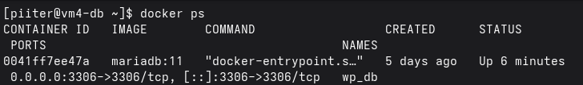

# VM4 - Base de datos (capa de datos)

## Función

Aloja la base de datos (MariaDB) en su propio contenedor Docker, aislada
en una máquina dedicada. Es la capa de datos de la arquitectura de 3
capas: solo VM2 (aplicación) tiene acceso a ella, y únicamente por la red
interna del laboratorio.

Esta VM se creó para corregir un diseño inicial en el que la base de datos
corría en la misma máquina que la aplicación (VM2): aunque estaban en
contenedores separados, no respetaba el aislamiento real que exige una
arquitectura de 3 capas (cada capa en su propio servidor).

## Especificaciones

| | |
|---|---|
| Distro | Rocky Linux |
| vCPU | 2 (1 procesador × 2 núcleos) |
| RAM | 4 GB |
| Disco | 30 GB |
| Hostname | vm4-db |

## Red

| Adaptador | Tipo | Interfaz | IP |
|---|---|---|---|
| 1 | NAT | `ens160` | asignada por DHCP (salida a internet) |
| 2 | Host-only (VMnet1) | `ens224` (conexión `host-only`) | 192.168.56.14/24 |

DNS: usa el DNS interno de VM5 (ver `docs/vm5-dns.md`):
```bash
sudo nmcli connection modify "ens160" ipv4.ignore-auto-dns yes
sudo nmcli connection modify "host-only" ipv4.dns 192.168.56.15
sudo nmcli connection up "ens160"
sudo nmcli connection up "host-only"
cat /etc/resolv.conf   # nameserver 192.168.56.15
```

Ya no hay entradas del laboratorio en `/etc/hosts`. Acceso por SSH sin
contraseña desde `ws`.

## Software instalado

- `docker-ce`, `docker-ce-cli`, `containerd.io`, `docker-compose-plugin`
- `node_exporter` (binario oficial, con servicio systemd propio)
- `epel-release`
- `bind-utils` (para `dig`)
- `open-vm-tools`
- Herramientas base: `vim`, `curl`, `wget`, `htop`, `tmux`, `bash-completion`

## Seguridad

- **SELinux:** activo en modo `Enforcing`.
- **firewalld:** activo, con estas reglas (el puerto de la base de datos
  solo se abre para la red interna del laboratorio, nunca hacia fuera):
  ```bash
  sudo firewall-cmd --permanent --add-service=ssh
  sudo firewall-cmd --permanent --add-source=192.168.56.0/24
  sudo firewall-cmd --permanent --add-port=3306/tcp
  sudo firewall-cmd --permanent --add-port=9100/tcp
  sudo firewall-cmd --reload
  ```

## Base de datos: MariaDB en Docker

`~/mariadb-docker/docker-compose.yml`:
```yaml
services:
  db:
    image: mariadb:11
    container_name: wp_db
    restart: unless-stopped
    environment:
      MYSQL_ROOT_PASSWORD: ${MYSQL_ROOT_PASSWORD}
      MYSQL_DATABASE: ${MYSQL_DATABASE}
      MYSQL_USER: ${MYSQL_USER}
      MYSQL_PASSWORD: ${MYSQL_PASSWORD}
    ports:
      - "3306:3306"
    volumes:
      - db_data:/var/lib/mysql

volumes:
  db_data:
```

Las credenciales en `.env` deben coincidir exactamente con las usadas en
`~/wordpress-docker/.env` en VM2. A diferencia del despliegue inicial, aquí
el puerto 3306 **sí se publica** (`ports`), porque WordPress se conecta
desde otra máquina, no desde el mismo `docker compose`.

## Monitorización

`node_exporter` instalado desde el binario oficial, en el puerto 9100,
vigilado por Prometheus desde VM3 (job `vm4-db`).

## Pasos realizados

1. Creación de la VM (Rocky Linux, Minimal Install) e instalación de
   Docker desde el repositorio oficial.
2. Configuración de red (NAT + host-only con IP fija) y acceso SSH desde
   `ws`.
3. Activación del firewall con las reglas de la sección **Seguridad**.
4. Despliegue del contenedor de MariaDB con `docker compose up -d`.
5. Verificación de conectividad desde VM2:
   ```bash
   curl -v telnet://vm4-db:3306
   ```
6. Reconfiguración de VM2 para apuntar su WordPress a esta base de datos
   (ver `docs/vm2-app.md`).
7. Instalación de `node_exporter` y apertura del puerto 9100.
8. Migración al DNS interno (VM5) con `nmcli`, comprobando que resuelve
   `vm2-app` por DNS con su entrada de `/etc/hosts` comentada y que
   `wp_db` sigue en marcha.

## Pendiente

- Ninguno relevante por el momento.

## Problemas encontrados

- Al configurar la red, la interfaz host-only quedó asignada a una subred
  distinta a la del resto del laboratorio (`192.168.54.0/24` en vez de
  `192.168.56.0/24`), porque al añadir el segundo adaptador en VMware se
  usó una red host-only genérica en lugar de la **VMnet1** compartida por
  las demás VMs. Además, la interfaz NAT apareció como `NO-CARRIER`
  (desconectada). Se solucionó revisando la configuración de cada
  adaptador en *VM Settings → Network Adapter* y asegurando que ambos
  apuntaran a las redes correctas (NAT y Custom → VMnet1).
- El acceso SSH inicial fallaba con "No route to host", causado por el
  problema de red anterior; se resolvió una vez corregida la asignación de
  adaptadores.

## Capturas


